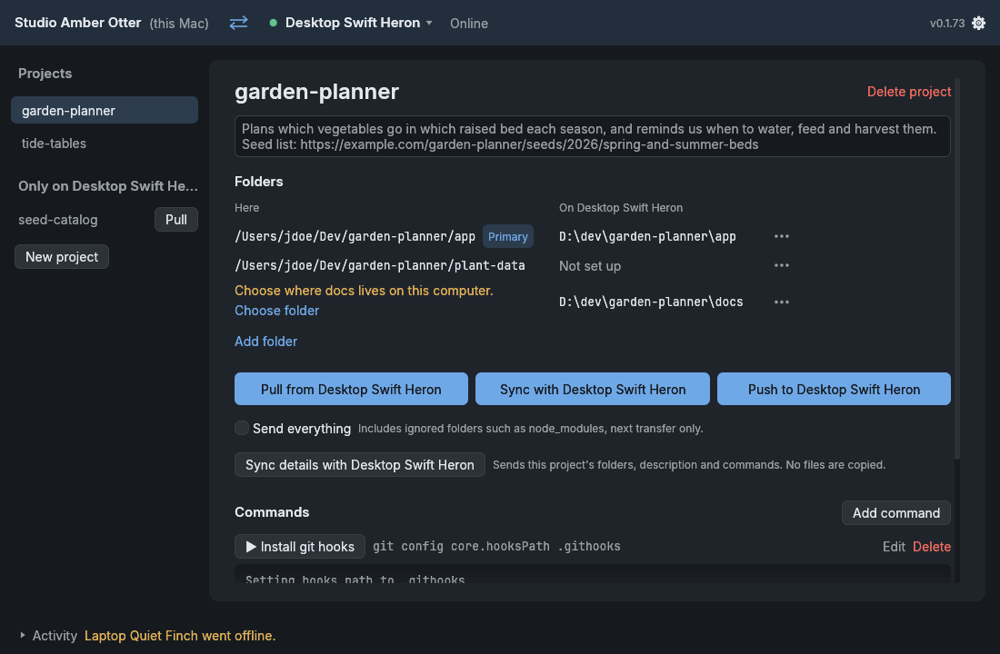

# Project Transfer

Project Transfer is a desktop app for macOS and Windows that copies project
folders between your computers on the same local network. Open it on two
computers, pair them once, and from then on push, pull or sync a project
with one button. The app finds the other computer by itself, talks to it
over its own encrypted connection, and shows you every change before it
writes anything.



## Install

You need Rust (stable) to build it. From the repository, run the helper for
your system:

| System  | Command                         |
| ------- | ------------------------------- |
| macOS   | `./install`                     |
| Windows | `.\install.ps1` (in PowerShell) |

Both run `cargo xtask install`, which you can also run yourself. If Windows
says running scripts is disabled, run
`powershell -ExecutionPolicy Bypass -File .\install.ps1` instead.

If Rust is missing, the helper offers to install it with
[rustup](https://rustup.rs), the official installer, and then goes on to
build the app. If you say no, it tells you how to install Rust yourself. On
Windows, rustup asks its own questions as well, and offers to install the
Visual Studio C++ build tools if they're missing. On a Mac, the build needs
Apple's command line tools; if they're missing, the build stops and macOS
offers to install them, after which you run `./install` again.

The installer builds a release binary and installs it:

| System  | What it does                                                                                                                                                                                                                            |
|---------|-----------------------------------------------------------------------------------------------------------------------------------------------------------------------------------------------------------------------------------------|
| macOS   | Builds `Project Transfer.app`, signs it ad hoc and installs it in `/Applications`, or in `~/Applications` when `/Applications` is not writable. A running copy is quit first. The old copy is kept aside until the new one is in place. |
| Windows | Copies `Project Transfer.exe` to `%LOCALAPPDATA%\Programs\Project Transfer` and adds a Start menu shortcut. A running copy is closed first.                                                                                             |

To install somewhere else, pass a folder:

```
./install --dest ~/Desktop/test-install
```

The installed app does not need the source checkout. Settings and paired
computers are kept when you reinstall.

## Push, pull or sync

Choose a project and a paired computer, then one of the three buttons under
the project's folders:

- **Pull from <other computer>** makes the copy on this computer match the
  other one.
- **Sync with <other computer>** pushes or pulls, whichever way has more
  files with newer changes. A file that differs between the two computers
  counts for the one where it changed last. A file only one computer has
  counts for that one, unless both computers last moved the project with
  each other, both have files in that folder outside `.git`, and the file
  is older than that transfer's preview: then the other computer removed
  it, and it counts for that one instead. The files in a `.git` folder
  count as one for each computer, however many a commit changed. A file
  whose content matches and only its time differs doesn't count, and with
  **Send everything** ticked, neither does a file the ignore list would
  leave out. On a tie, the computer with the most recent change wins; if
  that ties too, it pushes. Sync goes by the files' modified times, so keep
  both computers' clocks right. Sync is always one push or one pull, never
  a mix, so it needs the other computer to allow both.
- **Push to <other computer>** makes the copy on the other computer match
  this one.

Each one first shows what will change, and nothing is written until you
confirm. The preview of a sync starts with a line saying which way it went
and why, including how many of those files were removed since the last
transfer. If ignoring files from the preview turns a sync the other way,
the preview says so.

## Looking at a file before it moves

In a transfer's preview, click a file to see it. A file that is different on
the two computers shows both copies side by side, **Here** on the left and
**On <other computer>** on the right, with the lines that differ tinted. A
file only one computer has, or one where only the modified time differs,
shows one copy. Each copy says whether the transfer sends it, replaces it or
removes it.

The viewer shows text, up to the first 1 MB of each copy. Seeing the other
computer's copy needs that computer to allow pulls from this one, and a
version of Project Transfer that has the viewer.

## The Dock menu

While Project Transfer is open on a Mac, right-click its icon in the Dock to
repeat the last transfer you confirmed on this computer, such as **Push
garden-planner to Studio**, or to do the opposite, such as **Pull
garden-planner from Studio**. After a sync, the menu offers the sync, then a
pull and a push. Choosing one brings the window forward, selects the project
and the computer, and opens the same preview as the button, so nothing moves
before you confirm. A finished transfer's result closes first; while another
transfer or a sheet is open, choosing only brings the window forward.
Transfers another computer started don't count.

## Where folders go on the other computer

Each computer keeps its own path for every folder of a project. The folders
table shows both: **Here** and **On <other computer>**, with `~` standing
for the home folder there.

A folder the other computer doesn't have a path for yet gets one there by
default:

- A folder inside your home folder but outside the Projects folder, such
  as `~/.microsoft/usersecrets/<id>`, goes to the same place under the home
  folder there. Tools look for such folders in one fixed place.
- Any other folder goes into the Projects folder there: `<Projects>/<folder>`
  for a project with one folder, `<Projects>/<project>/<folder>` for one
  with several.

If that place is already part of another project there, the folder goes
to the Projects folder instead, so no folder ever mirrors over another
project's files.

**Sync details with <other computer>**, under the Pull, Sync and Push
buttons, sends the project's folders, description and commands without
copying any files, and brings back what the other computer has that this one
lacks. A new folder then shows its place in the **On <other computer>**
column before anything is pushed. Syncing details needs the other computer to
allow pushes from this one.

To put a folder somewhere else on the other computer, open the folder's
**…** menu and choose **Change folder on <other computer>…**. Enter a full
path there, or one starting with `~` for its home folder. The other
computer refuses its home folder, the top of a disk, and a place that
overlaps a folder of another project. Nothing moves when you save: the next
push copies the files to the new place.

## Commands

A project can keep the commands you run in it, such as `make deps` or a
release script. **Add command**, next to the **Commands** heading, asks for a
label and the command. Clicking the command's button runs it in the
project's primary folder, with your login shell on a Mac and PowerShell on
Windows, and shows its output underneath. Commands move with the project's
details but only run on the computer where you click them. A command that is
new on this computer, or changed since it last ran here, shows you its text
to check before it runs.

A command can ask for a value each time it runs, such as release notes. Put
a variable whose name starts with `INPUT_` where the value goes, for example
`./release.sh --notes "$INPUT_RELEASE_NOTES"`; the editor lists what the
command will ask for as you type. Clicking the command's button then shows a
box for each value, named after its variable: `INPUT_RELEASE_NOTES` asks for
**Release notes**. The value reaches the command as an environment variable,
as you typed it apart from spaces and line breaks at the end, so quotes, `$`
and new lines in it are passed along rather than read as part of the
command. On Windows, `$INPUT_RELEASE_NOTES`
and `$env:INPUT_RELEASE_NOTES` both work. What you type is not saved or
logged, and the boxes start empty each time.

To use a command in more than one project, tick **Share with other
projects** when you add or edit it. **Add command** in any project then has
a **Shared commands** tab, where you pick one and add it as:

- **Linked**: the command stays the same everywhere. Editing it in any
  project changes the shared command and every project that uses it. A
  linked command shows a **Shared** tag.
- **Separate**: a copy of its text as it is now. Changes to the copy stay
  in that project, and later changes to the shared command don't reach it.

**Unlink**, on a linked command's row, turns it into a separate command that
keeps its text. The **Shared commands** tab is also where you edit or delete
a shared command. Deleting it keeps the commands linked to it, as separate
commands with the same text. Deleting a linked command from a project
leaves the shared command, so you can add it again.

Shared commands go with every push, pull, sync and **Sync details**, so
paired computers get new, changed and deleted ones too. If both computers
changed the same shared command, the later change wins.

## Ignore list

Some folders are regenerated by tools and are not worth copying. By default
the app skips `node_modules`, `bin`, `obj`, `packages`, `dist`, `.build`,
`target`, `.vs`, `.idea`, `__pycache__`, `.pytest_cache`, `.gradle`, `.next`,
`.nuxt`, `.cache`, `.DS_Store` and `Thumbs.db`.

Patterns work like `.gitignore` lines. A path in a pattern starts inside
each project folder, not with the folder's name, and puts `/` between
names, even on Windows:

| Pattern      | Leaves out                                                |
| ------------ | --------------------------------------------------------- |
| `*.log`      | every file ending in `.log`                               |
| `exports/`   | every folder named `exports`, at any depth                |
| `/notes.txt` | `notes.txt` at the top of each project folder             |
| `/src/tmp/`  | the folder `src/tmp`, from the top of each project folder |

The easiest way to add one is from a transfer's preview. Point at a file
and choose **Ignore…**: the dialog offers patterns for it, from the file
alone up to every file of its type, and lists the files of this transfer
each one would leave out before you add it. **Ignore files…** opens the
same dialog for a pattern you type. Adding a pattern compares the folders
again, so the preview shows the difference straight away.

In Settings you can untick defaults, add and remove patterns, and add
**always include** patterns, which win over every ignore pattern except
inside a folder that is left out. Settings points out a pattern that
starts with a project folder's name and offers to drop it. The list of
the computer that starts a transfer applies to both sides, and changes
apply to the next transfer.

## Local network only

The app only talks to computers on your local network. Discovery uses mDNS,
which cannot leave the network, and the app refuses any address that is not a
private one (such as `192.168.x.x`, `10.x.x.x` or `172.16.x.x` to
`172.31.x.x`). Connections are encrypted with TLS. The app listens on TCP
port 47820, or on another free port if that one is taken; if a firewall asks,
allow it on private networks.

If your network blocks discovery, use **Add by address** with the address
shown in the other computer's Settings.
